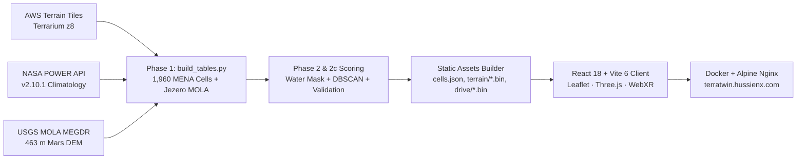

<div align="center">

# TerraTwin — Team Martian Phoenix

**Screening Earth Terrestrial Analogues for Mars's Jezero Crater across the Middle East and North Africa (MENA)**

[](https://terratwin.hussienx.com)
[](https://terratwin.hussienx.com)
[](https://github.com/HussienX123/TerraTwin)

[](https://react.dev)
[](https://threejs.org)
[](https://leafletjs.com)
[](https://vitejs.dev)
[](https://www.docker.com)

**[Launch Live Platform (terratwin.hussienx.com)](https://terratwin.hussienx.com)** &nbsp;·&nbsp; **[Explore Source Code](https://github.com/HussienX123/TerraTwin)**

</div>

---

## Table of Contents

- [Overview & Mission](#overview--mission)
- [Interactive Platform Capabilities](#interactive-platform-capabilities)
- [System Architecture & Repository Structure](#system-architecture--repository-structure)
- [Scientific Methodology & Honest Validation](#scientific-methodology--honest-validation)
- [Prototype Verification Status](#prototype-verification-status)
- [Quick Start & Local Development](#quick-start--local-development)
- [Production Deployment Guide](#production-deployment-guide)
- [Release Hardening & QA Audit](#release-hardening--qa-audit)
- [NASA Space Apps Submission Package](#nasa-space-apps-submission-package)
- [Credits, Data Sources & Compliance](#credits-data-sources--compliance)

---

## Overview & Mission

**TerraTwin** is an open-source, zero-login, client-side planetary analogue screening workbench built by **Team Martian Phoenix** for the **NASA Space Apps Challenge**.

Before planetary rovers, autonomy stacks, and field teams deploy to Mars, engineers test hardware and surface operations at terrestrial analogue sites on Earth. TerraTwin systematically scores **1,960 cells** on a **1° × 1° grid** across the Middle East and North Africa (**12°N–40°N, 10°W–60°E**) against target terrain and environmental measurements from **Jezero Crater, Mars** (**18.38°N, 77.58°E**).

Rather than presenting unverified black-box rankings, TerraTwin is designed around **scientific transparency**: surfacing divergence cells, documenting water-mask sensitivity, publishing negative-result validation metrics openly (`n = 6`), and separating exploratory screening hypotheses from field discovery claims.

> **Live Public Deployment:** [https://terratwin.hussienx.com](https://terratwin.hussienx.com) — opens directly in any modern browser or incognito window with zero login, zero tracking, and automatic fallback to 2D mapping on constrained hardware.

---

## Interactive Platform Capabilities

| Module | Engine | Description |
| :--- | :--- | :--- |
| **2D Screening Map** | Leaflet | Interactive 1° MENA grid over CARTO / OpenStreetMap tiles with custom weights, layer toggles, keyboard arrow picking, and percentile rankings. |
| **3D Globe Explorer** | `three.js` + `globe.gl` | Interactive planetary view with country borders, land/water cell overlays, and smooth transition to terrain patches. |
| **60 km Terrain Patch Pop-Out** | `three.js` | Registered digital elevation model (DEM) blocks with vertical exaggeration controls, slope classes, and NASA GIBS / Mars Trek imagery textures. |
| **Side-by-Side Jezero Comparison** | `three.js` | Direct heightfield visual comparison between screened Earth cells and the Jezero Crater MOLA crop. |
| **Rover Arcade Drive Mode** | `three.js` + Draco GLB | First-person cockpit and chase-camera Perseverance model traversal over heightfield surfaces with WASD keyboard and mobile touch joystick controls. |
| **WebXR Virtual Reality** | WebXR Device API | Table-scale VR inspection on Meta Quest Browser over HTTPS (gracefully gated on non-XR devices). |
| **Candidate Clusters & Evidence** | React 18 | DBSCAN spatial cluster rankings, score disagreement inspection, resolution tests (`1.0°` vs `0.25°`), and paste-ready citations. |
| **Guided Story & Play Mode** | React 18 | Self-guided 60-second onboarding sheet, classroom exercises, and field-screening missions with zero external state dependency. |

### Feature Flags & Resilience (`terra_twin_web/src/config/features.js`)

Risky 3D/XR surfaces are isolated behind clean runtime switches (`globe`, `terrain`, `vr`, `drive` — all enabled by default in production) plus React Error Boundaries, WebGL context-loss handlers, slow-network notices, and tile-host fallback (`CARTO` &rarr; `OpenStreetMap` &rarr; accessible plain-language status) so the core 2D screening map always remains usable.

---

## System Architecture & Repository Structure



```text
TerraTwin/
├── Dockerfile                  # Root multi-stage Node 20 -> Nginx Alpine build (Dokploy / PaaS)
├── nixpacks.toml               # Root Nixpacks build definition for PaaS auto-builders
├── README.md                   # Complete project handbook, methodology, deployment & QA audit
├── DEPLOY.md / SUBMISSION.md / RELEASE_CHECK.md  # Standalone reference copies
├── terra_twin_data/            # Scientific pipeline (Python), CSVs, configs & validation outputs
│   ├── build_tables.py         # Phase 1 DEM mosaic + NASA POWER ingestion
│   ├── mena_grid.csv           # 1,960 scored MENA grid cells (1° × 1°)
│   ├── mars_targets.csv        # Jezero Crater target feature vector
│   ├── targets.json            # Jezero manual climate target configuration
│   ├── phase2/                 # Phase 2 scoring engine, config.yaml, known_analogs.json & reports
│   └── phase2c/                # Phase 2c 0.25° vs 1.0° resolution sensitivity experiment
└── terra_twin_web/             # Production Vite + React + Three.js frontend application
    ├── Dockerfile              # App-level multi-stage Nginx build
    ├── nginx.conf              # Gzip, 1-yr immutable /assets/, no-cache /data/, SPA & /terrain fallback
    ├── vite.config.js          # Relative base ('./') and vendor manual chunking
    ├── scripts/                # Static JSON, 3D terrain patch & drive heightfield builders
    ├── public/                 # Precompiled cells.json, terrain patches, drive bins & Draco GLB model
    └── src/                    # Components, feature flags, ErrorBoundary, DriveOverlay & Play mode
```

---

## Scientific Methodology & Honest Validation

### 1. Grid & Target Definition
- **MENA Domain:** 1,960 cells at **1° × 1°** spatial resolution (**12°N–40°N**, **10°W–60°E**).
- **Water Filter (Phase 2b):** Excludes **310** likely water cells (**Rule A:** `elev_mean_m <= 0` AND `elev_range_m <= 5` AND `p90_slope_deg <= 0.05`, or **Rule B:** `elev_mean_m <= -200`), leaving **1,650 scored land cells**. Coastal mixed cells and 69 unflagged below-sea-level land/shallow cells are explicitly documented as limitations.
- **Mars Reference Target:** **Jezero Crater** (`18.4°N, 77.75°E`, window `77.0°–78.5°E`, `17.8°–19.0°N`) sampled via HTTP range requests from the 2.1 GB USGS MOLA 463 m global mosaic.

### 2. Multi-Criteria Scoring Weights (`terra_twin_data/phase2/config.yaml`)
- **Terrain Similarity (`0.40`):** `mean_slope_deg`, `p90_slope_deg`, `roughness` (slope standard deviation), and `elev_range_m` (no absolute elevation).
- **Environment (`0.30`):** Configured for `[t_range_c, precip_mm_yr]`. Because Jezero temperature extremes (`t_range_c`) and `precip_mm_yr` remain `null` in `targets.json`, scoring runs in documented **partial (aridity-only)** mode where lower Earth precipitation ranks higher. Note: `t_range_c` reflects NASA POWER climatological extreme-to-extreme range (`T2M_MAX - T2M_MIN`), not diurnal range.
- **Operational Suitability / Mobility (`0.30`):** Evaluates `p90_slope_deg` relative to an indicative `15°` rover slope threshold (explicitly flagged in UI as needing a cited engineering source).

### 3. Candidate Clusters & Exploratory Validation Results

In Run 2 (with water mask applied, exclusion radius `300 km` around known analogues, DBSCAN `eps_deg = 1.5`, `min_samples = 2`, top `5%` threshold `overall >= 84.0`):

| Rank | Cluster Center | Cells | Mean Overall | Notes |
| :---: | :--- | :---: | :---: | :--- |
| **1** | `(23.667°N, 33.0°E)` | 6 | `90.196` | Strong aridity (`96.74`) & terrain (`91.197`) match |
| **2** | `(20.0°N, 10.0°E)` | 2 | `88.354` | High aridity (`86.992`) & operational score (`97.029`) |
| **3** | `(17.5°N, 50.0°E)` | 2 | `88.014` | Top 5% screening candidate cluster |

**Negative-Result Transparency (`n = 6` Validation & `0.25°` Resolution Test):**
> *"Terrain similarity did not separate known analogs from negative controls (exploratory, n=6)."*

| Metric / Test | Run 1 (Unmasked) | Run 2 (Land-Only) | Finding |
| :--- | :---: | :---: | :--- |
| `terrain_score` ROC-AUC (`n=6`) | `0.50` | `0.12` | Terrain summary stats alone do not isolate analogues |
| `environment_score` ROC-AUC (`n=6`) | `0.62` | `0.62` | Aridity shows modest signal; `Western Desert` = `95.0` overall pct |
| `mobility_score` ROC-AUC (`n=6`) | `0.00` | `0.00` | Flat floodplains (`Nile Delta`, `Mesopotamia`) score `>96` mobility |
| `overall_score` ROC-AUC (`n=6`) | `0.25` | `0.25` | Sample size `n=6` is exploratory; weights were never tuned |
| **Phase 2c `0.25°` vs `1.0°` Primary Test** | `FAIL` (`0/4` at `1°`) | `FAIL` (`2/4` at `0.25°`) | Finer `0.25°` cells alone did not pass the pre-registered `>=3/4` rule |

---

## Prototype Verification Status

Conservative audit rendered live in the app's **Evidence &rarr; What works now** panel:

| Working in This Prototype | Not Included or Not Verified |
| :--- | :--- |
| ✓ 1° MENA screening grid (`1,960` cells) with multi-criteria scores and percentiles | ✗ WebXR on physical Meta Quest headset (tested in browser / emulator only) |
| ✓ Interactive 2D Leaflet map with cell picking, keyboard navigation, and layer toggles | ✗ Engineering rover mobility model (arcade simulation on coarse DEM + synthetic roughness) |
| ✓ 3D Globe visualization (`three.js`) with boundaries and cell overlay | ✗ Mineralogical / compositional matching (scoring uses slopes and climate only) |
| ✓ 3D terrain patch pop-out (60 km window) with vertical exaggeration & slope classes | ✗ High-resolution DEM outside featured analogue cells |
| ✓ Side-by-side comparison against Jezero Crater MOLA heightfield | ✗ Real-time Mars weather / verified `targets.json` temperature extremes |
| ✓ Rover driving simulation with keyboard WASD, touch joystick, and elevation contact | ✗ Desktop Safari & Firefox browser QA (verified on Chromium-based engines) |
| ✓ Top 3 candidate DBSCAN clusters and divergence cell inspection | ✗ Formal usability trials with students or planetary mission operations teams |
| ✓ Negative-result validation (`n=6`), automatic 2D WebGL fallback, zero `localStorage` lock-in | |

---

## Quick Start & Local Development

### Prerequisites
- **Node.js** `v18+` or `v20+`
- **Python** `3.10+` *(optional — only required to regenerate Phase 1/2/2c tables or static JSONs)*

### Run Locally
```bash
git clone https://github.com/HussienX123/TerraTwin.git
cd TerraTwin/terra_twin_web
npm install
npm run dev
```
Open `http://localhost:5173/` in your browser.

### Build & Preview Production Bundle
```bash
cd terra_twin_web
npm run build
npm run preview -- --host 0.0.0.0 --port 4173
```
- Because Vite builds with `base: './'`, the generated `terra_twin_web/dist/` folder works behind any static server, subpath, or CDN.
- Initial core JS bundle transfers at **~62 kB gzip** (`index.js`), code-splitting `three.js`, `globe.gl`, `leaflet`, and lazy pages so first paint completes rapidly on standard connections.

---

## Production Deployment Guide

**Production Instance:** [https://terratwin.hussienx.com](https://terratwin.hussienx.com)

### 1. Dokploy / Coolify / PaaS Deployment
Root-level `Dockerfile` and `nixpacks.toml` are configured for instant one-click deployment:
- **Repository:** `https://github.com/HussienX123/TerraTwin.git` (`main` branch)
- **Option A — Dockerfile (Recommended):** Set Build Type to `Dockerfile`, path `/Dockerfile` (or `terra_twin_web/Dockerfile` with Base Directory `/terra_twin_web`), Port **`80`**.
- **Option B — Nixpacks:** Root `nixpacks.toml` compiles `terra_twin_web/` and serves `dist/` via `serve -s dist -l 80` on Port **`80`**.

### 2. Standalone Docker + Alpine Nginx
```bash
git clone https://github.com/HussienX123/TerraTwin.git
cd TerraTwin
docker build -t terratwin-web .
docker run -d --restart unless-stopped -p 80:80 --name terratwin terratwin-web
```
Included `terra_twin_web/nginx.conf` provides:
- Multi-stage `node:20-alpine` &rarr; `nginx:alpine` image (< 30 MB runtime)
- Gzip compression across JS, CSS, JSON, SVG, HTML
- `1 year, immutable` cache headers for fingerprinted `/assets/`
- `no-cache, must-revalidate` headers for `index.html` and `/data/*.json`
- Single Page Application fallback (`try_files $uri $uri/ /index.html`) for deep links like `/?view=globe`
- Legacy `/terrain` redirect (`301` &rarr; `/?view=globe&terrain=1&focus=terrain`)

### 3. WebXR HTTPS Requirement & Reverse Proxy

> **Important:** WebXR sessions require a secure context (**HTTPS**). Meta Quest Browser disables VR sessions over plain HTTP.

<details>
<summary><strong>Expand Nginx SSL Reverse Proxy, Tunneling & Static Host Configurations</strong></summary>

#### Nginx HTTPS Proxy (`terratwin.hussienx.com`)
```nginx
server {
    listen 443 ssl http2;
    server_name terratwin.hussienx.com;

    ssl_certificate /etc/letsencrypt/live/terratwin.hussienx.com/fullchain.pem;
    ssl_certificate_key /etc/letsencrypt/live/terratwin.hussienx.com/privkey.pem;

    location / {
        proxy_pass http://127.0.0.1:80;
        proxy_set_header Host $host;
        proxy_set_header X-Real-IP $remote_addr;
        proxy_set_header X-Forwarded-For $proxy_add_x_forwarded_for;
        proxy_set_header X-Forwarded-Proto https;
    }
}
```

#### Local HTTPS Tunnel for Headset Testing
```bash
npx cloudflared tunnel --url http://localhost:4173
```

#### Static Host SPA Rewrites (`terra_twin_web/dist/`)
- **Netlify (`_redirects`):** `/* /index.html 200`
- **Vercel (`vercel.json`):** `{ "rewrites": [{ "source": "/(.*)", "destination": "/index.html" }] }`
- **GitHub Pages:** Copy `dist/index.html` to `dist/404.html` (already included in our release build steps).

</details>

---

## Release Hardening & QA Audit

Phase 9 release hardening status: **PASS**

### 1. Content, Claims & Placeholder Audit
| Check | Status | Verification Summary |
| :--- | :---: | :--- |
| **"validated" / "accurate" / "proven"** | **PASS** | 0 occurrences in user-facing UI copy |
| **"geology" (as score label)** | **PASS** | 0 occurrences; strictly labeled *Terrain similarity*, *Environment*, *Operational suitability* |
| **"TODO" / "TEAM TO FILL" / "lorem"** | **PASS** | 0 placeholders across all source and UI files |
| **Unintended `null` / `undefined` / `NaN` / `n/a`** | **PASS** | Guarded with safe fallbacks; `"n/a"` only shown where field values are legitimately absent |
| **Mandatory Disclaimers** | **PASS** | Candidates: *"Screening hypotheses, not discoveries."*; Drive footer: *"Arcade scale. Coarse terrain data plus synthetic detail."* |
| **Judge Incognito & Sandbox Test** | **PASS** | Opens without login; zero `localStorage` dependency (`try/catch` guarded); only approved tile hosts (`basemaps.cartocdn.com`, `tile.openstreetmap.org`) |

<details>
<summary><strong>Expand 10-Cell Automated JSON Data Parity Audit (100% Match against <code>cells.json</code>)</strong></summary>

| Cell ID | Lat | Lon | Terrain | Env | Mobility | Overall | Completeness | Status |
| :--- | :---: | :---: | :---: | :---: | :---: | :---: | :---: | :---: |
| `earth_+30.50_+39.50` | 30.5 | 39.5 | 87.932 | 75.955 | 93.701 | 86.070 | 1.0 | PASS |
| `earth_+15.50_+8.50` | 15.5 | 8.5 | 56.034 | 28.138 | 95.330 | 59.454 | 1.0 | PASS |
| `earth_+12.50_+41.50` | 12.5 | 41.5 | 22.923 | 19.709 | 57.603 | 32.363 | 1.0 | PASS |
| `earth_+33.50_+38.50` | 33.5 | 38.5 | 64.099 | 47.544 | 95.402 | 68.524 | 1.0 | PASS |
| `earth_+20.50_-6.50` | 20.5 | -6.5 | 47.847 | 67.071 | 97.244 | 68.433 | 1.0 | PASS |
| `earth_+19.50_+1.50` | 19.5 | 1.5 | 51.850 | 43.966 | 91.695 | 61.438 | 1.0 | PASS |
| `earth_+18.50_+27.50` | 18.5 | 27.5 | 71.619 | 94.178 | 92.628 | 84.689 | 1.0 | PASS |
| `earth_+16.50_-4.50` | 16.5 | -4.5 | 47.423 | 24.015 | 96.295 | 55.062 | 1.0 | PASS |
| `earth_+33.50_+28.50` | 33.5 | 28.5 | *Water* | *Water* | *Water* | *Water* | 1.0 | PASS |
| `earth_+14.50_+59.50` | 14.5 | 59.5 | *Water* | *Water* | *Water* | *Water* | 1.0 | PASS |

</details>

---

## NASA Space Apps Submission Package

- **Team Name:** **Martian Phoenix**
- **Live Public Application:** [https://terratwin.hussienx.com](https://terratwin.hussienx.com)
- **Public GitHub Repository:** [https://github.com/HussienX123/TerraTwin](https://github.com/HussienX123/TerraTwin)

### Demo Compliance Checklist
- [x] Public link tested in clean incognito browser (`https://terratwin.hussienx.com`) with zero login
- [x] Data sources credited openly in application UI & documentation
- [x] Zero NASA logos, zero NASA-branded imagery, zero photos of individuals
- [x] Explicit AI-use disclosure documented cleanly
- [ ] Submission video (&le; 30 s, English / subtitled, 18+ compliance) attached to challenge portal

### Project Description (~300 Words)

> **TerraTwin: Screening Terrestrial Analogues for Jezero Crater — Team Martian Phoenix**
>
> **Overview:** Planetary exploration missions rehearse surface operations, test rover navigation systems, and evaluate autonomy software on Earth before flight. TerraTwin is an open-source screening workbench built by Team Martian Phoenix that identifies 1° terrestrial analogue candidate regions for Mars's Jezero Crater across the Middle East and North Africa (MENA).
>
> **Methodology & Data Sources:** TerraTwin evaluates 1,960 grid cells (`1° × 1°` resolution) across North Africa and the Arabian Peninsula, excluding 310 likely water cells to score 1,650 land cells. The pipeline computes multi-criteria similarity against Jezero Crater target values derived from the Mars Orbiter Laser Altimeter (MOLA) 463 m DEM and AWS Terrain Tiles (Terrarium z8, ~470–598 m/px), paired with NASA POWER Climatology v2.10.1 reanalysis datasets. Screening weights combine terrain geometry (`0.40`: mean slope, p90 slope, roughness, elevation range), surface aridity (`0.30`: partial mode using precipitation while Mars temperature extremes remain null), and operational suitability (`0.30`: p90 slope against an indicative 15° rover threshold).
>
> **Honest Scientific Findings & Limitations:** TerraTwin delivers exploratory screening hypotheses, not confirmed geological discoveries. In an exploratory validation test against 4 published analogue sites and 2 negative controls (`n=6`), terrain geometry alone did not separate known analogues from flat floodplains at either 1° or 0.25° (`0/4` vs `2/4` beating both controls; Run 2 terrain ROC-AUC `0.12`). While the Western Desert inverted channels ranked at the `95.0` overall percentile, other known sites ranked modestly. Mineralogical data is excluded, and coarse 1° cells omit meter-scale hazards.
>
> **Interactive Platform & AI Transparency:** Deployed publicly at `https://terratwin.hussienx.com`, the zero-login web interface integrates a 2D Leaflet screening map, a 3D Three.js globe and 60 km terrain inspector, an arcade rover simulation, and WebXR table-scale viewing. AI tools (Claude for specifications, Antigravity coding agent for pipeline and frontend execution) operated strictly under human oversight; no scientific observations or scores were generated by AI.

---

## Credits, Data Sources & Compliance

| Dataset / Service | Attribution |
| :--- | :--- |
| **NASA POWER** | Prediction Of Worldwide Energy Resources Climatology API v2.10.1 (`T2M`, `T2M_MAX`, `T2M_MIN`, `PRECTOTCORR`) |
| **NASA MOLA** | Mars Global Surveyor Mars Orbiter Laser Altimeter 463 m/px MEGDR digital elevation mosaic (USGS Astrogeology) |
| **NASA Mars Trek** | Orbital surface imagery layers for Jezero Crater |
| **NASA GIBS** | Global Imagery Browse Services Landsat / WELD annual surface imagery composites |
| **AWS Terrain Tiles** | Mapzen / Amazon Web Services Open Data Registry Terrarium DEM tiles (SRTM, ASTER GDEM, GMTED2010) |
| **CARTO & OpenStreetMap** | Voyager / Positron basemap tiles and OpenStreetMap contributors (ODbL) |

### AI-Use Transparency Disclosure
We used **Claude (Anthropic)** for method strategy and technical specifications, and the **Antigravity** coding agent to implement and execute the data pipeline, validation scripts, and React/Three.js frontend under human supervision. Weights and features were never tuned to force validation passes (all Run 1 vs Run 2 water-mask changes are archived), and no generative AI fabricated any scientific observation, metric, or validation result.

*Strict Visual Compliance: No NASA logos, no NASA-branded imagery, and no photographs of individuals are used anywhere in this repository or live site.*
